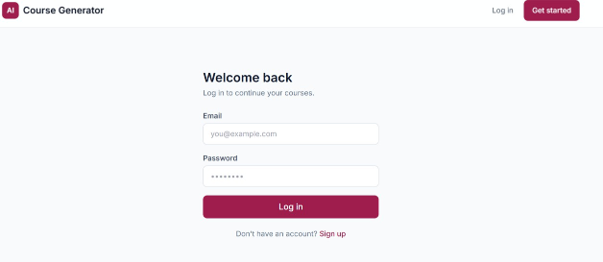
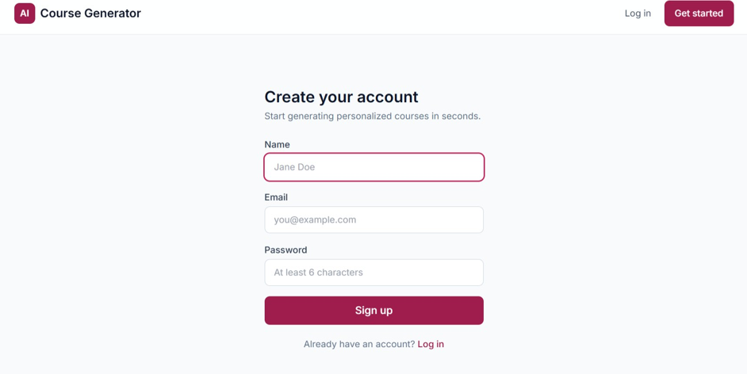
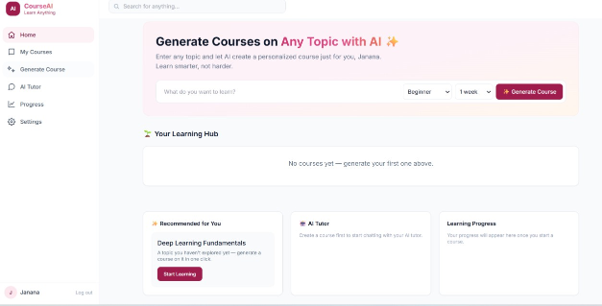
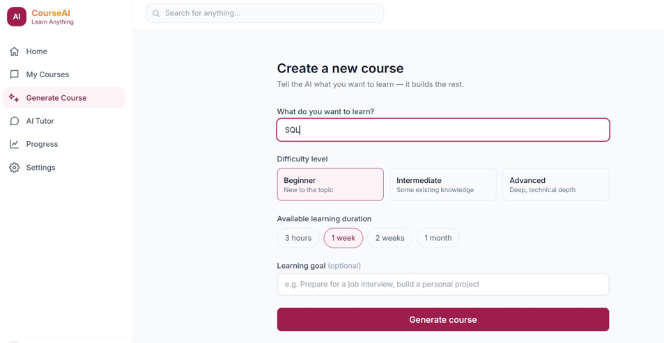
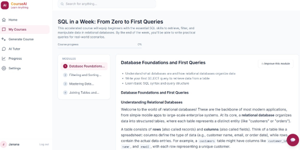
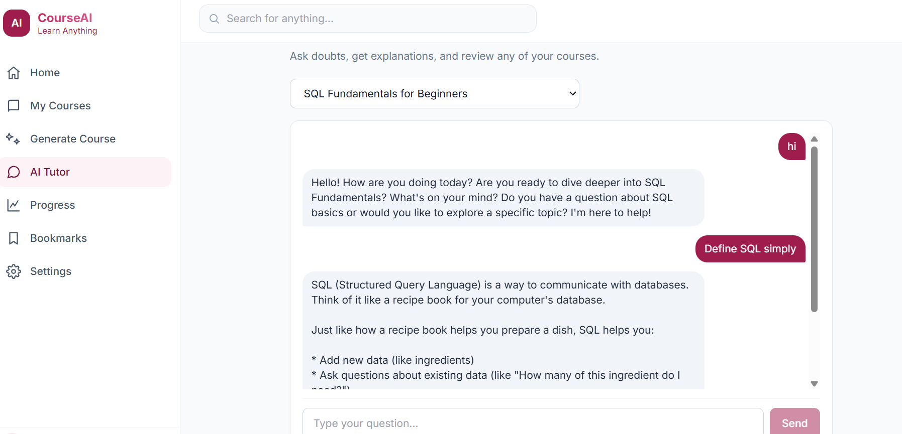
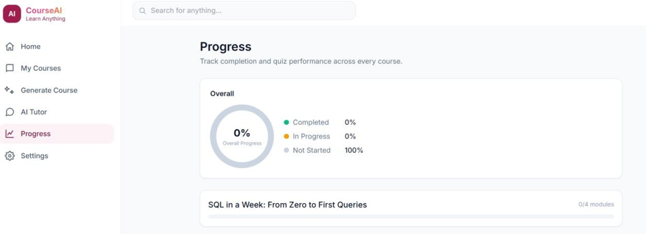

<div align="center">

#  CourseAI — AI Course Generator

### Type any topic. Get a complete, personalized course in seconds.

Syllabus · Lessons · Real-world & code examples · Quizzes · Assignments · AI Tutor · Progress tracking


</div>

---

##  About

**AI COURSE GENERATOR** is a full-stack Generative AI web application that turns any topic into a structured learning path. A learner enters *what* they want to learn, their *difficulty level*, and *how much time* they have. The app then generates a personalized syllabus, writes each lesson on demand, creates quizzes and assignments, answers doubts through a context-aware AI tutor, and tracks progress.

This is a **working application, not a mockup**: every button calls a real backend endpoint, which calls a real LLM and stores real data in a database.

###  What makes it different

- **Bring-your-own LLM.** One OpenAI-compatible client works with **Mistral, Groq, Google Gemini, OpenAI, or a fully local Ollama model**. Switching provider means editing three lines in `.env`, with no code changes.
- **Runs 100% free and offline** with Ollama, with no API key and no rate limits.
- **Lazy generation.** The outline appears instantly. Each module's lesson is generated only when the learner opens it, which saves tokens and time.
- **Self-healing JSON pipeline.** If the model returns malformed JSON, the app asks the model to repair its own output before failing.
- **Adaptive learning.** Score low on a quiz and click *Improve this module*: the lesson is regenerated using your quiz score as context.
- **Context-aware AI tutor** that knows which course and module you are on, and remembers the conversation.

---

## 📸 Screenshots

### Authentication

| Login | Registration |
|:---:|:---:|
|  |  |

### Dashboard & Course Creation

| Dashboard | Course Generation |
|:---:|:---:|
|  |  |

### Learning Experience

| Generated Course Content | AI Tutor |
|:---:|:---:|
|  |  |

### Progress Tracking



---

##  Features

| Feature | Description |
|---|---|
|  **Authentication** | Register / login with JWT tokens and bcrypt-hashed passwords |
|  **AI Course Generation** | Topic → analysis → learning objectives → full syllabus with modules and subtopics |
|  **Personalization** | Beginner / Intermediate / Advanced and 3 hours → 1 month; every prompt is calibrated to these |
|  **Lesson Content** | Markdown explanations, real-world examples and code examples, generated per module |
|  **Quizzes & Assignments** | Auto-generated MCQs with per-question explanations, plus a hands-on assignment |
|  **Adaptive Regeneration** | "Improve this module" rewrites weak lessons using the learner's last score |
|  **AI Tutor** | Chat assistant aware of the current course, module and conversation history |
|  **Progress Tracking** | Module completion, average quiz score and a donut chart |
|  **Bookmarks & Settings** | Save content, manage profile |
|  **Completion Page** | Summary of stats when a course is finished |

---

##  Architecture

```
┌───────────────┐    REST / JSON    ┌──────────────┐   OpenAI-compatible API   ┌────────────────────────┐
│   Frontend    │ ────────────────▶ │   Backend    │ ────────────────────────▶ │  LLM provider          │
│ React + Vite  │ ◀──────────────── │   FastAPI    │ ◀──────────────────────── │  Mistral · Groq · Gemini│
│ Tailwind CSS  │                   └──────┬───────┘                           │  OpenAI · Ollama (local)│
└───────────────┘                          │ SQLAlchemy ORM                    └────────────────────────┘
                                           ▼
                                   ┌───────────────┐
                                   │ SQLite / Postgres │
                                   └───────────────┘
```

**Layers**

- **Frontend:** React (Vite) + Tailwind CSS. Talks only to the backend REST API.
- **Backend:** Python + FastAPI. Owns auth, business logic, prompt orchestration and persistence.
- **LLM layer:** `app/llm/client.py` wraps any OpenAI-compatible chat-completions endpoint. `app/llm/prompts.py` holds every prompt template.
- **Database:** SQLite by default (zero setup). Set `DATABASE_URL` to switch to Postgres.

---

##  AI Workflow

```
User Input → Topic Analysis → Learning Objectives → Course Outline
→ Module Generation → Content Generation → Examples
→ Quiz & Assignment Generation → Personalized Course → AI Tutor → Progress Tracking
```

| Stage | Where it happens | Trigger |
|---|---|---|
| Topic analysis → course outline | `POST /courses` → `syllabus_prompt()` | On course creation (eager, so the learner sees the outline instantly) |
| Module content + examples | `GET /courses/{id}/modules/{id}` → `module_content_prompt()` | Lazily, the first time a learner opens a module |
| Quiz + assignment | Same call → `quiz_prompt()` | Generated together with module content |
| Personalization | Every prompt includes `difficulty` and `duration` | Baked into every generation call |
| AI Tutor | `POST /tutor/chat` → `tutor_system_prompt()` | On demand, with course + module + chat history as context |
| Progress tracking | `GET /progress/{id}` | Aggregates quiz attempts and module completion |
| Regeneration | `POST /courses/{id}/modules/{id}/regenerate` → `regeneration_prompt()` | Manual ("Improve this module"), uses the last quiz score |

---

##  Tech Stack

| Layer | Technology |
|---|---|
| Frontend | React, Vite, Tailwind CSS, React Router |
| Backend | Python, FastAPI, Uvicorn, Pydantic |
| Database | SQLite (default), PostgreSQL-ready, SQLAlchemy ORM |
| Auth | JWT (`python-jose`), bcrypt (`passlib`) |
| AI | OpenAI Python SDK against any OpenAI-compatible endpoint |
| Supported LLMs | Mistral, Groq (Llama 3), Google Gemini, OpenAI, Ollama (local) |

---

##  Folder Structure

```
ai-course-generator/
├── backend/
│   ├── app/
│   │   ├── main.py                 # FastAPI app, CORS, router registration, /health
│   │   ├── config.py               # env-based settings
│   │   ├── database.py             # SQLAlchemy engine/session
│   │   ├── models.py               # ORM tables
│   │   ├── schemas.py              # Pydantic request/response models
│   │   ├── auth.py                 # JWT + bcrypt
│   │   ├── llm/
│   │   │   ├── client.py           # OpenAI-compatible client, JSON mode + retry
│   │   │   └── prompts.py          # every prompt template
│   │   └── routers/
│   │       ├── auth_router.py
│   │       ├── courses_router.py   # the core generation pipeline
│   │       ├── tutor_router.py
│   │       └── progress_router.py
│   ├── requirements.txt
│   └── .env.example
├── frontend/
│   ├── src/
│   │   ├── api/                    # client.js (all backend calls), AuthContext.jsx
│   │   ├── components/             # Sidebar, TopBar, CourseCard, TutorChat, DonutChart, ...
│   │   ├── pages/                  # Landing, Login, Register, Home, CreateCourse,
│   │   │                           # MyCourses, CourseView, Quiz, TutorPage,
│   │   │                           # ProgressPage, Bookmarks, Settings, Completion
│   │   ├── App.jsx, main.jsx, index.css
│   ├── package.json, vite.config.js, tailwind.config.js
│   └── .env.example
├── docs/                           # README screenshots
└── README.md
```

---

##  Getting Started

### Prerequisites

- Python **3.10 – 3.12**
- Node.js **18+**
- **One** of: an LLM API key (Mistral / Groq / Gemini / OpenAI) **or** [Ollama](https://ollama.com) installed locally (no key needed)

### 1. Clone the repository

```bash
git clone https://github.com/SaiDeepthi-22/ai-course-generator.git
cd ai-course-generator
```

### 2. Backend setup

```bash
cd backend
python -m venv venv

# Windows
venv\Scripts\activate
# macOS / Linux
source venv/bin/activate

pip install -r requirements.txt
```

Create your environment file:

```bash
# Windows: copy .env.example .env
cp .env.example .env
```

Now edit `backend/.env` using **one** of the provider options below.

### 3. Choose your LLM provider

Every provider uses the same three variables. Pick one block:

<details open>
<summary><b>Option A: Ollama (free, local, no API key)</b></summary>

```env
LLM_API_KEY=ollama
LLM_BASE_URL=http://localhost:11434/v1
LLM_MODEL=llama3.2
```

Install Ollama from https://ollama.com/download, then download the model once:

```bash
ollama pull llama3.2
```

Local generation is slower (1–3 minutes for the first course on a laptop) but has no rate limits.
</details>

<details>
<summary><b>Option B: Groq (free tier, very fast)</b></summary>

```env
LLM_API_KEY=your-groq-key
LLM_BASE_URL=https://api.groq.com/openai/v1
LLM_MODEL=llama-3.3-70b-versatile
```
</details>

<details>
<summary><b>Option C: Google Gemini</b></summary>

```env
LLM_API_KEY=your-gemini-key
LLM_BASE_URL=https://generativelanguage.googleapis.com/v1beta/openai/
LLM_MODEL=gemini-3.8-flash
```

Model names change often. If you get a 404, check the model list in Google AI Studio.
</details>

<details>
<summary><b>Option D: Mistral</b></summary>

```env
LLM_API_KEY=your-mistral-key
LLM_BASE_URL=https://api.mistral.ai/v1
LLM_MODEL=mistral-small-latest
```
</details>

<details>
<summary><b>Option E: OpenAI</b></summary>

```env
LLM_API_KEY=sk-your-openai-key
LLM_BASE_URL=https://api.openai.com/v1
LLM_MODEL=gpt-4o-mini
```
</details>

Then add the common settings at the bottom of the same `.env` file:

```env
DATABASE_URL=sqlite:///./course_generator.db
JWT_SECRET=replace-with-a-long-random-string
JWT_EXPIRE_MINUTES=1440
FRONTEND_ORIGIN=http://localhost:5173
```

>  Never commit your real `.env`. It is already listed in `.gitignore`.

### 4. Run the backend

```bash
python -m uvicorn app.main:app --reload --port 8000
```

Open **http://localhost:8000/docs** for the interactive Swagger UI. If it loads, the backend is running.

### 5. Run the frontend (second terminal)

```bash
cd frontend
cp .env.example .env      # Windows: copy .env.example .env
npm install
npm run dev
```

Open **http://localhost:5173**, register an account and generate your first course.

---

## 🔌 API Reference

Full interactive docs are at **http://localhost:8000/docs**.

| Method | Path | Purpose |
|---|---|---|
| POST | `/auth/register` | Create account, returns JWT |
| POST | `/auth/login` | Returns JWT |
| GET | `/auth/me` | Current user profile |
| PATCH | `/auth/me` | Update profile |
| POST | `/courses` | Generate a new course (topic → AI syllabus) |
| GET | `/courses` | List the learner's courses |
| GET | `/courses/{id}` | Course detail and module list |
| GET | `/courses/{id}/modules/{id}` | Lazily generates and returns module content |
| GET | `/courses/{id}/modules/{id}/assessments` | Quiz (answers hidden) and assignment |
| POST | `/courses/{id}/modules/{id}/quiz` | Submit answers, get score and explanations |
| POST | `/courses/{id}/modules/{id}/regenerate` | Adaptive regeneration of a weak module |
| POST | `/courses/{id}/complete` | Mark course completed |
| POST | `/tutor/chat` | AI tutor Q&A with course and module context |
| GET | `/tutor/history/{course_id}` | Chat history |
| GET | `/progress/{course_id}` | Completion % and average quiz score |
| GET | `/health` | Health check, shows the active LLM model |

---

##  Database Schema

Seven tables, created automatically on first run:

| Table | Purpose |
|---|---|
| `users` | Accounts (name, email, hashed password) |
| `courses` | Topic, difficulty, duration, goal, AI-generated title and description, status |
| `modules` | Outline (subtopics, objectives) and lazily generated lesson content and examples |
| `assessments` | Quiz and assignment payloads per module |
| `quiz_attempts` | Score and answers for each attempt |
| `module_progress` | Whether each module is completed |
| `tutor_messages` | Persistent AI tutor chat history |

LLM output (lessons, examples, questions) is stored as JSON text columns, so the schema stays stable even when the model's output varies in shape.

---

##  Testing

**Manual checklist**

1. Register a new account → redirects to the dashboard.
2. Open **Generate Course**, enter `Python Basics`, *Beginner*, *1 week* → a course page appears with a title, description and module list.
3. Open a module → content, examples and code snippets appear.
4. Take the quiz → per-question results and explanations appear.
5. Ask the AI Tutor a question about the module → a contextual answer.
6. Score low, then click **Improve this module** → the content visibly changes.
7. Complete all modules → completion page with stats.
8. Visit `/docs` and try any endpoint directly.

**Sample request**: `POST /courses`

```json
{
  "topic": "Machine Learning",
  "difficulty": "beginner",
  "duration": "1 week",
  "learning_goal": "Build my first ML model"
}
```

**Sample response** (abridged)

```json
{
  "id": 1,
  "title": "Machine Learning Foundations for Beginners",
  "status": "ready",
  "modules": [
    {"id": 1, "title": "What is Machine Learning?"},
    {"id": 2, "title": "Data and Features"},
    {"id": 3, "title": "Your First Model"}
  ]
}
```

**Sample quiz submission**

```json
// POST /courses/1/modules/1/quiz
{ "assessment_id": 1, "answers": {"q1": "a", "q2": "c"} }
// → { "score": 50.0, "correct": 1, "total": 2, "feedback": [ ... ] }
```

---

##  Troubleshooting

| Problem | Cause and fix |
|---|---|
| `401 Invalid API Key` | The key is wrong, or `.env` isn't being read. Check there are no quotes or spaces, and restart the server |
| Error mentions `aistudio.google.com` or `'str' object has no attribute 'choices'` | `LLM_BASE_URL` points at a website instead of the API. Use the exact URL from the provider block above |
| `404 model not found` | Model name is wrong or retired. Check the provider's model list. For Ollama, run `ollama pull <model>` first |
| `503 high demand` / `429 rate limit` | Provider is overloaded or you hit the free-tier limit. Wait a minute, switch model, or switch provider |
| `uvicorn.exe ... blocked by Application Control policy` (Windows) | Run `python -m uvicorn app.main:app --reload --port 8000` instead |
| `.env` changes not applying | Settings load at startup. Restart the backend |
| CORS error in the browser | `FRONTEND_ORIGIN` must match the URL Vite prints, usually `http://localhost:5173` |
| Malformed JSON errors with small local models | Retry, or use a stronger model (for example `llama3.1` or `qwen2.5:7b`) |
| `pip install` fails on `bcrypt` / `passlib` | Use Python 3.10–3.12 |

---

## Security Notes

- API keys live only in `backend/.env`, which is git-ignored. Only `.env.example` is committed.
- Passwords are hashed with bcrypt. Sessions use signed JWTs.
- Quiz answers are stripped from the assessments endpoint, so learners can't read them from the network tab.
- Set a long random `JWT_SECRET` before any real deployment.

---

## Future Improvements

- Stream lesson content token by token (SSE) instead of waiting for the full response
- RAG grounding from textbooks and official docs to reduce hallucination on niche topics
- Runtime hot-swapping between LLM providers from the Settings page
- Exportable PDF course summary and completion certificates
- Spaced-repetition quiz retries based on past wrong answers
- Multi-language course generation
- Admin analytics (popular topics, difficulty distribution)
- Rate limiting and per-user token budgets
- Docker Compose for one-command setup

---

##  Author

**Samatham Sai Deepthi**
B.Tech (AI & ML), Siddhartha Institute of Technology and Sciences, Hyderabad

[](https://github.com/SaiDeepthi-22)
[](https://linkedin.com/in/samatham-sai-deepthi)

---

<div align="center">

If you found this project useful, consider giving it a ⭐

</div>
